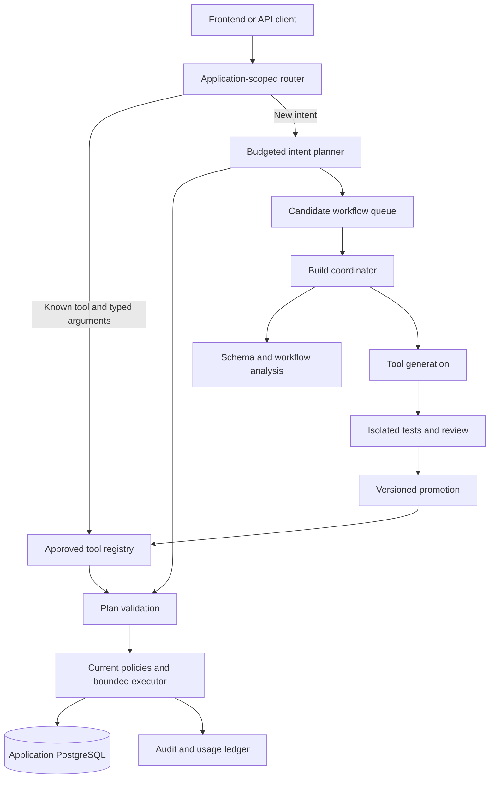

# Adaptive application backends: proposed architecture

Status: approved v0.2 design; implementation in progress. Baseline: Superagent v0.1, commit
`b8543ba`. This document responds to the request for application-scoped agents,
on-demand backend generation, reusable tools/APIs, tracking, caching, SOLID
boundaries, local installation, and lower total cost.

## Intent and assumptions

Automate the creation and maintenance of the backend operations an application
actually needs. Spend model tokens on understanding new workflows and building
tools; use deterministic execution for established workflows. A workflow built
for one user should be reusable by another authorized user of the same app.

Assumptions: local-first, Python 3.12+, PostgreSQL 16+, developer-owned policies,
and explicit application registration. The application owner supplies its schema,
identity integration, intended workflows, and business rules. Schema alone cannot
reveal approval requirements, tenant boundaries, or business intent. Applications
and users are separate concepts; several users may belong to one application.
Schemas describe the overall application backend and are never generated per
user. v0.2 agents may draft tool manifests and revision-bound schema-change
proposals for owner review; only approved tools execute data operations.

Current v0.1 already discovers schema, validates plans, executes transactions,
and records audit/idempotency state. It does not orchestrate subagents, expose
reusable parameterized tool endpoints, generate backend packages, or cache plans
across new requests. Its planner runs while a database transaction is open.

## Approach choices

| Approach | Benefit | Cost / limitation |
| --- | --- | --- |
| Parameterized plans and generated wrappers first (recommended) | Reuses the tested executor; repeat calls require no model; easy to validate and export | Initially limited to the supported plan language |
| Arbitrary generated backend code immediately | Broader business logic sooner | Requires code isolation, dependency governance, release management and stronger review from the start |
| Persistent agents for every app/request | Flexible interactive reasoning | Repeated model calls and idle workers undermine the cost objective |

Use the first approach, then add sandboxed extensions for workflows the plan
language cannot express. Tools are real reusable backend capabilities, not saved
responses or a promise that arbitrary application behavior is understood.

## Request path and build path



Requests do not wait for a team of agents on every call. Known tools execute
directly. A supported new intent can use v0.1's validated execution and record a
candidate for later reuse. An unsupported workflow becomes a proposed build job;
it is not executed until an approved implementation exists. Building a tool does
not automatically retry a previous mutation.

## Application registration and isolation

Each registration contains an application ID, a local config/artifact directory,
an environment-variable reference to database credentials, an authentication
adapter, schema/policy revisions, tool registry, and build/inference budgets.
Registration is opt-in; do not scan or attach to other installed applications.

Run one process per application first. Later, a supervisor may manage multiple
application workers with distinct credentials, directories, and authenticated
routing. A caller cannot select a different application's credentials merely by
sending an `app_id`. Prefer separate databases/runtime roles; a shared database
requires explicit tenant policies and isolation tests.

Users within an application can share a tool definition. They cannot share
cached private results, identities, permissions, idempotency keys, or runtime
credentials. Cross-application sharing initially means explicitly importing a
generic template and rebuilding/reviewing it against the destination schema.

## Tool contract and lifecycle

An immutable tool version records:

- Application ID, tool ID/version, purpose, and typed input/output contracts.
- Parameterized plan, or later an approved isolated extension artifact.
- Server-injected identity bindings; callers cannot supply owner/user/tenant
  identity arguments that override their authenticated context.
- Referenced tables/columns, read/write effects, required policy revision,
  schema fingerprint, runtime contract version, and artifact digest.
- Provenance, generated tests, review outcome, build cost, promotion history,
  invocation counts, failures, latency and last-use time.

Lifecycle: `candidate -> building -> testing -> approved -> active -> deprecated`.
Any active version can be `revoked`; failed builds are recorded as `failed`.
In-flight builds for the same app/contract/revisions are deduplicated. Tool IDs
are stable; versions are immutable. API responses/audits identify the version
actually used. Rollback selects a prior compatible version, not stale permissions.

A plan template replaces approved value positions with typed argument slots or
server identity bindings. Table/column names, operation kinds, policy expressions,
and reference topology are fixed. Never infer parameters by replacing every
literal in a successful plan: literals may be security restrictions or business
constants. Owners declare contracts, or builders propose them for review.

Example: `create_task(title, project_id, assignee_name, due_date)` performs a name
lookup and insert, while `creator_id` comes from the verified caller. The same
definition can serve Alice and Rahul; each execution checks their project access
and current policy. No user ID from the original example is embedded in the tool.

Expose a shared tool executor endpoint first. Generate named
FastAPI routes, Pydantic models, OpenAPI descriptions and client bindings later
from the approved manifests. These wrappers call the governed executor rather
than duplicating authorization or generating unrestricted SQL.
v0.2 retains the existing runtime result envelope as its output contract;
generated per-tool typed response models follow in v0.3.

## Agents, rules and growth

Build coordinator roles: schema/workflow analyst, tool builder, test/review worker,
and release/maintenance worker. Roles can be deterministic programs when no
model reasoning is needed. Run dependent steps sequentially. Fan out independent
workflow builds or independent tests only; dependency ordering remains explicit.

Default maximum: two concurrent build jobs per application and one initial model
attempt plus one repair attempt per job. Per-app budgets can lower these bounds.
A build uses a disposable database, limited files, and no production credentials
or unrestricted network. Record job dependencies, lease ownership, elapsed time,
token usage, errors, and artifact provenance. Limit global concurrency as well
as per-app concurrency. Idle applications require no persistent model session.

Developer-owned rules specify table/column permissions, invariants, external
capabilities, build budgets, allowed libraries, promotion mode, and retention.
Start with manual promotion. Later permit automatic promotion only for reviewed
classes of changes under an owner-defined rule; agents cannot grant themselves
permissions, relax invariants, change budgets, or deploy schema migrations.

Schema/policy changes invalidate affected tools before their next execution.
Revalidate, test against a disposable schema, then publish a compatible version.
Production migrations, new external capabilities, and permission expansions
remain separate owner-controlled changes. Periodic drift checks supplement
deployment/startup checks; continuously racing out-of-band DDL is not supported.
Inactive artifacts may be archived, while their audit references remain valid.

## Caching and routing

1. **Tool definitions:** reuse across authorized users in the same application;
   reload by immutable digest. Execute against live state every time.
2. **Bound plan templates:** cache structural validation by app, tool version,
   schema fingerprint, policy revision and runtime version. Authorization,
   row state, constraints and invariants are checked on every execution.
3. **Exact intent routing:** only reviewed, narrowly defined routes with typed
   extraction can avoid the model. Frontends should prefer explicit tool IDs.
   Similar wording or an embedding match is only a candidate, never mutation
   authorization. Ambiguous inputs require clarification or planning.
4. **Read results:** deferred initially. If enabled later, require explicit TTL,
   authenticated user/tenant and policy scope in the key, plus invalidation.
5. **Mutations:** never skip a new write because a response is cached. Existing
   idempotency replay is the separate, identity-scoped retry mechanism.

## SOLID boundaries

| Principle | Design consequence |
| --- | --- |
| Single responsibility | Separate app registration, routing, template binding, registry, execution, building, promotion, and usage accounting |
| Open/closed | Add providers and tool kinds through explicit adapters; retain the core validation boundary |
| Liskov substitution | All tool executors satisfy the same contracts for identity, limits, errors, effects and audits; run conformance tests |
| Interface segregation | Request execution does not depend on build/deploy interfaces; schema readers cannot promote tools |
| Dependency inversion | Router depends on registry/planner/executor protocols; provider and storage implementations are injected |

Keep the current compiler, policy checks and Executor. Introduce narrow adapters
around Runtime rather than replacing its tested safety behavior. Maintain
readable app artifacts and Git-compatible generated packages, not only opaque
agent memory.

## Cost objective and accounting

Let `H` be hosting, `D` database cost, `N` monthly requests, `h` the share routed
without inference, `p` average planning cost, `B` monthly generation/review cost,
and `M` human maintenance cost:

```text
Adaptive backend = H_runtime + D + N * (1-h) * p + B + M_runtime
Conventional     = H_backend + D + M_backend
```

Build cost includes all subagent calls, repairs, evaluations and sandbox compute.
Track billable failures as well as successful calls in a separate ledger;
transaction rollback must not erase inference-cost records. Provider bills
remain authoritative, especially after crashes or missing usage metadata.
Bound cold-request planning by budgets too. When a model budget is exhausted,
approved deterministic tools remain available; new intents/builds return an
explicit budget error and do not silently switch to unsafe execution.

With the previous assumed rates, 100,000 requests at $0.0024 each cost $240 in
planning. If 95% use direct tools, planning drops to $12, plus build costs.
That 95% is a target on a declared representative workload, not a measured
natural-language cache hit rate. If illustrative build cost is $5/month and
both hosting/database budgets are $21.15, totals are $38.15 versus $21.15 before
human maintenance. Saving one genuinely measured $50 maintenance hour would
change the comparison to $38.15 versus $71.15; the saving is not established.

Equal hosting plus additional positive AI/build cost cannot beat a conventional
backend on infrastructure alone. A lower bill needs measured hosting savings,
zero-inference tools at comparable hosting, or a total-cost comparison including
real development savings. Sharing a process across apps may reduce overhead,
but compare it against an equally consolidated conventional backend. Never
claim that local/self-hosted models or local compute have zero economic cost.

## Installation and release experience

Current supported entry point: Git-source `uv tool install --python 3.12`,
`superagent init --from-db`, owner policy configuration, `init-db`, and `run`.
Use the existing README for executable v0.1 instructions.

Proposed releases add a versioned Docker image and Compose bootstrap for the
runtime and optional sample PostgreSQL. Existing databases remain supported.
Persist config/registry/artifacts in a volume; inject secrets at runtime. Add a
`doctor` command for database/provider compatibility, pending setup and schema
drift. Native uv support should be smoke-tested on Linux/macOS/Windows; Docker
requires Docker Desktop or an equivalent supported Linux engine. Test upgrades,
uninstall, restore and rollback rather than promising support for every system.

## Roadmap and acceptance

| Release | Deliverable | Exit evidence |
| --- | --- | --- |
| v0.2 | Approved parameterized plan tools, direct execution, registry/versioning, cost ledger, doctor | Same tool used by two users with fresh authorization; 1,000 known-tool calls make zero provider calls; drift/revocation stop execution |
| v0.3 | Application-specific generated Python/FastAPI packages and bounded build workers | Clean install/export/import; valid wrappers; failed/malicious builds cannot activate; duplicate jobs share one artifact |
| v0.4 | Multi-app supervisor, independent job fan-out, maintenance/invalidation and budget controls | Cross-app access denied; two-job limit enforced; worker crash/recovery does not double-publish; measured repeat-workload costs |
| v0.5 | Isolated custom domain extensions and approved external API adapters | Network/filesystem/DB capability restrictions tested; external effects use outbox/idempotency; no false distributed rollback claim |

Benchmark deterministic CRUD, CRUD with an AI planner each time, and this design
on identical capabilities, hardware, data, traffic and auth. Include setup and
policy-review time, builds/repairs, tokens, rejects, concurrency, throughput and
p50/p95 latency. Publish results even when the conventional backend is cheaper.
Do not market generic unattended backend development as proven by task demos.

Each later release gets its own reviewed spec and executable task plan after
the preceding release's measurements. The accompanying plan specifies v0.2;
the later milestones are architectural scope, not authorization to implement
everything in one change.

Move cold-path inference outside long-lived application transactions as part of
the build/budget orchestration work. Preserve request deduplication using short
reservation transactions, leases and fencing before execution; do not trade
exactly-once committed mutations for lower connection usage. v0.2's direct-tool
path already avoids holding a transaction during a model call.
